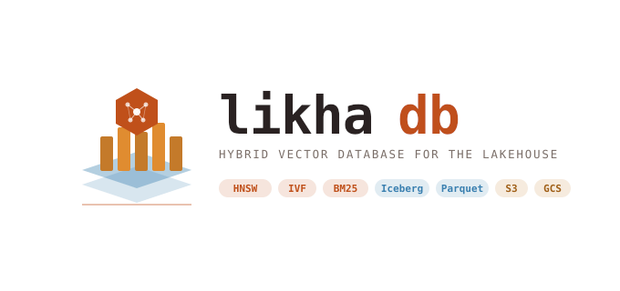
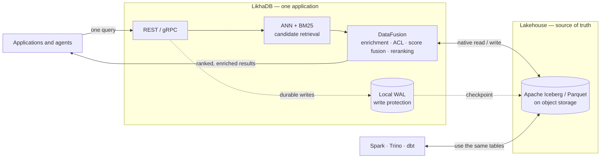

# likhadb

<p align="center">
  
</p>

**Vector search native to Apache Iceberg. No second database. No sync pipeline.**

Your embeddings already live in your lakehouse. LikhaDB serves fast ANN and hybrid search directly over your Iceberg tables — the same tables Spark, Trino, and dbt already read and write. There is nothing to extract, no vector store to feed, and no pipeline to keep consistent.

For crate structure, index algorithms, query flows, and persistence design, see [`docs/ARCHITECTURE.md`](docs/ARCHITECTURE.md).

## Why

Standalone vector databases make your lakehouse the source of truth, then force you to copy out of it: extract embeddings, load them into a separate store, and run a pipeline to keep the two consistent forever. The costs compound — duplicated data, staleness between write and searchability, and a second system to scale, secure, and monitor.

LikhaDB removes the split. The Iceberg table **is** the store. The index is a derived accelerator over it: it rebuilds from Iceberg when cold and updates as new data lands, so a row written by Spark becomes searchable without an ETL hop.

## How it fits

LikhaDB is one application exposed over REST and gRPC. A query can combine ANN search,
BM25, DataFusion enrichment, ACL filtering, score fusion, and reranking in one request.
Parquet and Iceberg integration keep the application connected to the same tables used by
Spark, Trino, and dbt, while the local WAL protects writes between durable checkpoints.



## Getting started

**Prerequisites:** Rust stable toolchain.

```sh
# Run all tests
cargo test --workspace

# Run FTS tests (requires the fts feature)
cargo test -p likhadb-store --features fts
cargo test -p likhadb-fts

# Run benchmarks
cargo bench -p likhadb-bench

# Stress test (requires a running server — see §Stress test below)
cargo run -p likhadb-stress

# Lint (zero warnings enforced)
cargo clippy --workspace -- -D warnings
cargo clippy -p likhadb-store --features fts -- -D warnings
```

## Index types

| Index | Type | When to use |
|---|---|---|
| `FlatIndex` | Exact brute-force | Small datasets or when precision matters most |
| `IvfIndex` | Approximate (IVF k-means) | Large datasets, latency-sensitive workloads |
| `IvfIndex` + SQ8 | Approximate + quantized | Memory-constrained deployments (4× smaller) |
| `HnswIndex` | Approximate (graph) | Sub-millisecond recall on large datasets |

## Python SDK

A typed Python client ships under `sdk/python/`. It supports both sync and async usage and covers the full REST API surface.

**Install (development):**

```sh
cd sdk/python
pip install -e ".[dev]"
```

**Sync usage:**

```python
from likhadb import LikhaDB

with LikhaDB("http://localhost:8080") as db:
    db.create_collection("docs", dim=384, metric="cosine")
    col = db.collection("docs")
    col.insert(1, vector=[0.1] * 384, payload={"title": "hello"})
    results = col.search([0.1] * 384, k=5, include_payload=True)
```

**Async usage:**

```python
from likhadb import AsyncLikhaDB

async with AsyncLikhaDB("http://localhost:8080") as db:
    await db.create_collection("docs", dim=384, metric="cosine")
    col = db.collection("docs")
    await col.insert(1, vector=[0.1] * 384, payload={"title": "hello"})
    results = await col.search([0.1] * 384, k=5, include_payload=True)
```

Index types (`flat`, `ivf`, `ivf_sq8`, `hnsw`), hybrid search, Parquet import/export, and per-request payload filters are all supported. See [`sdk/python/`](sdk/python/) for the full API.

## Distance metrics

| Metric | Formula | Best for |
|---|---|---|
| `Metric::L2` | `sqrt(Σ(aᵢ − bᵢ)²)` | General-purpose, unnormalised embeddings |
| `Metric::Cosine` | `1 − dot(a,b) / (‖a‖·‖b‖)` | Semantic similarity, text embeddings |
| `Metric::Dot` | `−Σ(aᵢ·bᵢ)` (negated so lower = better) | Pre-normalised vectors, recommendation |

## Stress test

`likhadb-stress` is a breaking-point stress tester that pushes the server beyond normal operational limits to find where it breaks, validate error handling under pressure, and verify SLO compliance. It runs five sequential phases:

| Phase | What it does |
|---|---|
| **1. Baseline** | Inserts and queries across flat, IVF, and HNSW indexes plus a hybrid BM25+vector collection — establishes normal-load throughput and latency percentiles |
| **2. Ramp** | Doubles concurrency from 1 → 2 → 4 → … → `--max-concurrency`, stopping when error rate exceeds `--error-threshold` or p99 breaches `--p99-slo-ms` — reports the breaking point |
| **3. Spike** | Warm-up at base concurrency → sudden burst to `--spike-factor×` concurrency → recovery; reports p99 degradation ratio and whether the system recovers cleanly |
| **4. Soak** | Sustained load for `--soak-secs` split into 5 equal windows; compares first vs. last window p95 to detect latency drift from memory leaks or lock contention |
| **5. Chaos** | Fires a 1:1:1:1:1 mix of valid queries, valid inserts, ghost-collection queries, wrong-dimension inserts, and nonexistent-vector GETs; counts unexpected 5xx separately from expected 4xx; confirms server health after the barrage |

Every HTTP call goes through `send_timed()` which enforces `--timeout-ms` per request. All five phases report error rates, not just latency.

**Quick start** — with a running server (`./dev.sh`):

```sh
# Full run (all five phases, default settings)
cargo run -p likhadb-stress

# Stress phases only, shorter duration
cargo run -p likhadb-stress -- \
  --skip-baseline \
  --soak-secs 15 \
  --chaos-ops 500

# Force-detect a breaking point at low concurrency (useful for CI)
cargo run -p likhadb-stress -- \
  --skip-baseline \
  --max-concurrency 16 \
  --error-threshold 1.0 \
  --p99-slo-ms 200
```

**Key flags:**

| Flag | Default | Description |
|---|---|---|
| `--timeout-ms` | 5000 | Per-request timeout in milliseconds (0 = disabled) |
| `--max-concurrency` | 64 | Concurrency ceiling for the ramp phase |
| `--error-threshold` | 5.0 | Error rate % that declares a breaking point |
| `--p99-slo-ms` | 500 | p99 latency SLO in milliseconds |
| `--spike-factor` | 4 | Concurrency multiplier for the spike phase |
| `--soak-secs` | 30 | Duration of the soak phase |
| `--chaos-ops` | 1000 | Number of random operations in the chaos phase |
| `--skip-{baseline,ramp,spike,soak,chaos}` | — | Individually disable any phase |
| `--no-cleanup` | — | Retain test collections for post-run inspection |

## Roadmap

| Item | Status | Description |
|---|---|---|
| **A — Foundation** | Done | Exact brute-force search, in-memory, JSON metadata filtering |
| **B — Approximate k-NN** | Done | IVF (k-means + SQ8 quantization) + HNSW graph-based search |
| **C — Persistence** | Done | Snapshot + WAL crash durability, atomic checkpoint |
| **D — Concurrency** | Done | `Arc<RwLock<WalManager>>`, background checkpoint task |
| **E — API** | Done | HTTP REST (axum) + gRPC (tonic) |
| **F — Observability** | Done | Prometheus metrics (`/metrics`) + structured JSON tracing |
| **F1 — Full-text search** | Done | Tantivy BM25 index per collection, opt-in via `fts` feature |
| **F2 — Hybrid search** | Done | RRF fusion of vector similarity + BM25 scores |
| **L — Lakehouse I/O** | In Progress | Parquet import/export to MinIO/S3-compatible object stores (`minio` feature); GCS and Iceberg planned |
| **Q — DataFusion pipeline** | In Progress | Post-ANN enrichment, ACL enforcement, multi-signal score fusion, reranking (`likhadb-query` crate) |
| **T — Vector transforms** | Planned | Insert-time L2 normalisation, scalar scaling |
