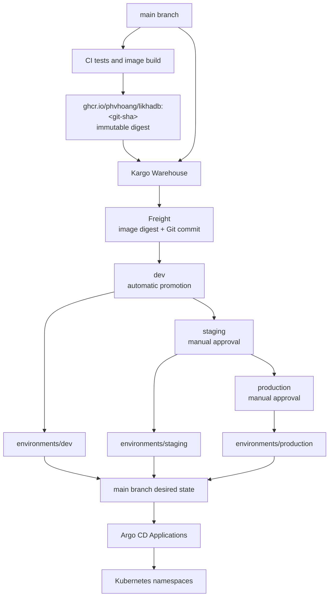

# Environment Promotion with Kargo and Argo CD

## Status

Draft implementation plan. This document describes the intended deployment and
promotion design; the Kubernetes, Argo CD, Kargo, and CI resources described here
have not yet been implemented.

## Goals

- Build and publish an immutable LikhaDB container image after changes merge to `main`.
- Discover new images as Kargo Freight.
- Promote the same verified image through `dev`, `staging`, and `production`.
- Use Argo CD as the only component that applies application manifests to a Kubernetes cluster.
- Keep every promotion auditable and reproducible through Git.
- Provide a local `kind` environment that exercises the same manifests used by a real Kubernetes cluster.
- Keep credentials and generated secrets out of the repository.

## Non-goals

- Designing a highly available LikhaDB deployment. The current local WAL and persistent-volume model requires one active LikhaDB replica per environment.
- Provisioning a production Kubernetes cluster, DNS, ingress controller, storage class, certificate manager, or cloud load balancer.
- Selecting a production secret-management platform. The first implementation will remain compatible with External Secrets, SOPS, and cloud secret managers.
- Automatically promoting releases into staging or production.

## Current state

The repository currently contains:

- A multi-stage `Dockerfile` for the LikhaDB server.
- A GitHub Actions workflow that verifies the image can be built for pull requests.
- A Docker Compose development environment.
- REST and gRPC health-capable services on ports `8080` and `50051`.
- Persistent application state stored under `/data`.

The repository does not yet contain Kubernetes manifests, an image publishing workflow, Argo CD applications, Kargo resources, or a GitOps bootstrap process.

## Proposed architecture



Kargo selects and promotes immutable image digests. A promotion renders and validates the target environment, commits its desired state under `environments/` on `main`, and requests an Argo CD refresh. Argo CD reconciles that desired state into Kubernetes. Kargo does not directly deploy the LikhaDB workload.

## Repository layout

The implementation is expected to add the following structure:

```text
deploy/
├── base/
│   ├── deployment.yaml
│   ├── service.yaml
│   ├── pvc.yaml
│   └── kustomization.yaml
└── overlays/
    ├── dev/
    ├── staging/
    └── production/

gitops/
├── argocd/
│   ├── project.yaml
│   ├── dev-application.yaml
│   ├── staging-application.yaml
│   └── production-application.yaml
└── kargo/
    ├── project.yaml
    ├── warehouse.yaml
    ├── stages/
    │   ├── dev.yaml
    │   ├── staging.yaml
    │   └── production.yaml
    └── promotion-tasks/
        └── promote-image.yaml

hack/gitops/
├── create-cluster.sh
├── install-argocd.sh
├── install-kargo.sh
├── bootstrap.sh
├── verify.sh
└── delete-cluster.sh
```

Exact filenames may change where grouping related resources makes the manifests clearer, but the separation between application manifests, Argo CD resources, Kargo resources, and local tooling should remain.

## Kubernetes application manifests

### Base

The Kustomize base will define:

- A `Deployment` running one LikhaDB replica.
- A persistent volume claim mounted at `/data`.
- A ClusterIP `Service` exposing REST port `8080` and gRPC port `50051`.
- Startup, readiness, and liveness probes using the REST health endpoint.
- Resource requests and limits suitable as safe development defaults.
- A non-root security context where supported by the runtime image.
- Graceful termination settings compatible with LikhaDB's shutdown and final checkpoint behavior.

The deployment must use the image digest selected during promotion. It must not
deploy `latest` or another mutable tag.

### Environment overlays

Each environment will have a separate namespace and overlay. Overlays may vary:

- Namespace and resource names.
- Persistent-volume capacity.
- Resource requests and limits.
- Logging level and other non-secret configuration.
- Environment-specific labels and annotations.

Secrets will be referenced by name and will not be stored in plaintext in these
overlays.

### Stateful limitation

LikhaDB currently writes to a local WAL under `/data`. Multiple independent replicas cannot safely share or independently mutate this state. All initial
overlays will therefore use one replica. Increasing the replica count is outside the scope of this work and requires an explicit application-level HA design.

## Image publishing

The existing Docker build workflow will be extended or complemented by a release workflow with the following behavior:

- Pull requests build the image without pushing it.
- A successful merge to `main` builds and pushes the image to
  `ghcr.io/phvhoang/likhadb`.
- The image is tagged with the full or unambiguous Git commit SHA.
- OCI source and revision metadata are attached to the image.
- The workflow targets `linux/amd64` and `linux/arm64` so the same release works on common Linux clusters and local Apple Silicon machines.
- GitHub's short-lived `GITHUB_TOKEN` is used to publish the package.
- Kargo ultimately records and promotes the registry digest, even when discovery begins from a SHA tag.

Image signing and SBOM generation are desirable follow-up hardening tasks, but they are not required for the first end-to-end promotion flow.

## Argo CD design

### AppProject

A dedicated Argo CD `AppProject` will constrain:

- The allowed Git repository.
- The allowed destination cluster.
- The `dev`, `staging`, and `production` namespaces.
- The Kubernetes resource kinds the applications may create.

### Applications

There will be one Argo CD `Application` per environment. Each application will:

- Track `main`.
- Read rendered manifests from `environments/<environment>`.
- Deploy only to its environment namespace.
- Enable automated synchronization, pruning, and self-healing.
- Create its destination namespace when necessary.
- Report health and synchronization status back to Kargo.

Automated Argo CD sync is safe in this design because promotion approval occurs before Kargo changes the environment directory. Once a promotion is approved, Argo
CD should reconcile it without a second manual deployment action.

## Kargo design

### Project and Warehouse

The Kargo project will contain a `Warehouse` that subscribes to:

- The LikhaDB image repository in GHCR.
- The Git repository and relevant source branch or commit, where required to associate application configuration with Freight.

Image discovery will accept only the intended immutable SHA tag format. Freight will retain the resolved image digest so later stages deploy exactly the artifact tested by earlier stages.

### Stages

The promotion path is strictly ordered:

```text
Warehouse -> dev -> staging -> production
```

- `dev` subscribes directly to Warehouse Freight and may promote automatically.
- `staging` subscribes only to Freight verified in `dev` and requires manual approval.
- `production` subscribes only to Freight verified in `staging` and requires manual approval.

Staging and production must not independently discover a newer image during a promotion. They promote the exact Freight previously verified upstream.

### Reusable promotion task

The promotion task will:

1. Clone the Git repository.
2. Check out the current `main` branch as the destination working tree.
3. Update the target Kustomize overlay to use the Freight image digest.
4. Render the overlay.
5. Validate the rendered Kubernetes resources.
6. Commit the generated desired state with Freight metadata in the message.
7. Push the generated environment manifest to `main`.
8. Refresh or update the corresponding Argo CD application.
9. Wait for Argo CD to report the application synchronized and healthy.

Promotion fails if rendering, validation, Git push, Argo CD synchronization, or application health fails. A failed promotion must not be marked verified.

### Environment directories

Kargo will write desired state to:

- `environments/dev/manifests.yaml`
- `environments/staging/manifests.yaml`
- `environments/production/manifests.yaml`

Each promotion changes only one environment file, giving every environment an
auditable history within the normal `main` log. Rendering to a single file makes
updates idempotent and prevents stale resources from surviving a promotion.
The selected overlay comes from the Freight's exact source commit, while Git
push retry/rebase integrates the generated change with the latest `main`.

## Credentials and secrets

The implementation requires credentials for:

- Kargo to push generated environment commits to `main` on GitHub.
- Kargo and the cluster to read GHCR if the image package is private.
- Kargo to interact with the intended Argo CD applications.
- Clients to authenticate to LikhaDB through `LIKHADB_API_TOKEN`.

Credential manifests containing placeholder names may be committed. Real tokens, passwords, generated admin credentials, and Docker registry authentication data
must not be committed.

The local bootstrap process will accept credentials through environment variables or ignored local files and create the required Kubernetes Secrets. Documentation
will identify the minimum token scopes. A production installation should replace this mechanism with its chosen secret-management platform.

## Local reference environment

A reproducible `kind` cluster will serve as the reference environment. Bootstrap tooling will:

1. Verify required commands and versions.
2. Create a local cluster with a stable name.
3. Install pinned Argo CD and Kargo releases into separate namespaces.
4. Wait for their controllers to become ready.
5. Apply the Argo CD and Kargo project resources.
6. Print port-forward and login instructions without publicly exposing control planes or admin interfaces.
7. Provide a verification command and a separate teardown command.

Scripts should be idempotent where practical. Installation versions will be pinned during implementation after checking the current supported releases in the official documentation.

Because Kargo and Argo CD must reach GitHub and GHCR, the complete promotion flow requires network access and appropriate credentials. Manifest rendering and
validation should remain usable without those credentials.

## Validation strategy

Static validation will cover:

- Every Kustomize overlay renders successfully.
- Rendered resources pass schema validation.
- Argo CD and Kargo custom resources use APIs supported by the pinned controller versions.
- No overlay contains mutable image tags.
- No committed resource contains a real credential.
- Shell scripts pass a shell linter where available.

End-to-end validation will cover:

1. Build and publish a SHA-tagged image.
2. Confirm the Warehouse discovers it as Freight.
3. Promote it automatically to `dev`.
4. Confirm Kargo updates `environments/dev` and Argo CD reports the application healthy.
5. Manually promote the same Freight to `staging` and then `production`.
6. Confirm all environments reference the same image digest.
7. Introduce reversible deployment drift and verify Argo CD repairs it.
8. Promote an older verified Freight and confirm rollback completes successfully.

## Rollback

Rollback will use Kargo to promote an older verified Freight. Operators should not manually edit the live Deployment or generated environment file as the normal rollback procedure. Re-promoting Freight preserves the audit trail and ensures Git, Argo CD, Kargo, and the cluster agree on the desired release.

Application data rollback is separate from application image rollback. Because LikhaDB persists WAL and snapshot data, compatibility across versions must be considered before rolling back a release that changed the on-disk format.

## Implementation phases

### Phase 1: Kubernetes baseline

- Add the base and three overlays.
- Add probes, persistent storage, security settings, and resource defaults.
- Add local rendering and schema validation.

### Phase 2: Image publication

- Add multi-architecture GHCR publishing from `main`.
- Retain non-publishing pull-request builds.
- Verify immutable SHA tag and digest metadata.

### Phase 3: Argo CD

- Add the project and three applications.
- Configure environment directory tracking and automated reconciliation.
- Verify namespace isolation and drift correction.

### Phase 4: Kargo

- Add the project, Warehouse, stages, and reusable promotion task.
- Configure automatic development promotion and manual higher-environment promotion.
- Verify Git commits, Argo CD health checks, and exact-digest propagation.

### Phase 5: Local bootstrap and documentation

- Add pinned `kind`, Argo CD, and Kargo bootstrap tooling.
- Document credentials, common operations, rollback, and teardown.
- Run the complete promotion path and record any platform prerequisites.

## Acceptance criteria

The implementation is complete when:

1. All three Kustomize overlays render and validate.
2. A successful merge to `main` can publish an immutable LikhaDB image.
3. Kargo discovers the image as Freight.
4. Development promotion updates Git and becomes healthy through Argo CD.
5. The identical image digest can be manually promoted to staging and production.
6. Argo CD detects and repairs application deployment drift.
7. An older verified Freight can be promoted as a rollback.
8. No credentials or generated administrative passwords are committed.
9. The local bootstrap and teardown procedures are documented and repeatable.

## Assumptions and decisions to verify during implementation

- GitHub and GHCR are used because the repository origin is GitHub. The package visibility and required read credentials still need to be confirmed.
- The target image name is `ghcr.io/phvhoang/likhadb`.
- `kind` is the local reference cluster, not the production provisioning tool.
- Development promotion is automatic; staging and production promotions require explicit approval.
- Generated environment manifests are stored as directories on `main`.
- Initial deployments use one replica and one persistent volume per environment.
- Ingress and public exposure remain cluster-specific and outside the initial implementation.

## References

- [Kargo documentation](https://docs.kargo.io/)
- [Kargo quickstart](https://docs.kargo.io/quickstart/)
- [Argo CD getting started](https://argo-cd.readthedocs.io/en/stable/getting_started/)
- [Argo CD automated sync](https://argo-cd.readthedocs.io/en/stable/user-guide/auto_sync/)
- [Kustomize documentation](https://kubectl.docs.kubernetes.io/references/kustomize/)
